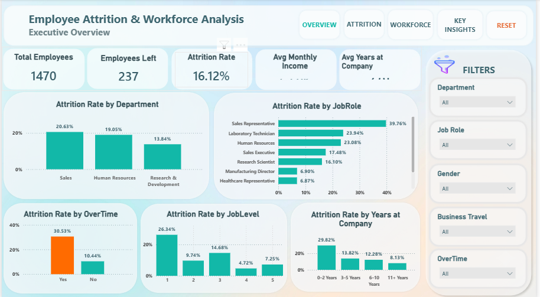

# HR Employee Attrition Analysis

## Project Overview

This project explores employee attrition to understand workforce trends and identify employee characteristics associated with leaving an organization.

The project uses Python for data cleaning and exploratory data analysis (EDA), SQL for querying and analysis, and Power BI for dashboard development and visualization.

## Project Objectives

- Analyze overall employee attrition.
- Explore attrition patterns across departments and job roles.
- Examine relationships between attrition and employee characteristics.
- Identify workforce trends that can support data-informed HR decisions.

## Tools and Technologies

- **Python:** Pandas, NumPy, Matplotlib, Seaborn
- **SQL:** Data querying, filtering, aggregation, and analysis
- **Power BI:** Dashboard development and data visualization
- **Jupyter Notebook:** Python analysis and documentation

## Dataset

- **Rows:** 1,470
- **Columns:** 35
- **Format:** CSV

The dataset includes employee information such as age, department, job role, monthly income, job satisfaction, overtime, and attrition status.

See the `data/` folder for dataset documentation. The dataset source and applicable usage terms should be verified before redistributing it publicly.

## Project Workflow

1. **Data understanding and preparation:** Review the dataset structure and assess data quality.
2. **Exploratory data analysis:** Explore employee attributes and attrition patterns using Python.
3. **SQL analysis:** Use queries to investigate workforce trends and compare employee groups.
4. **Dashboard development:** Present relevant metrics and analysis in Power BI.
5. **Insights and recommendations:** Interpret the verified findings to support data-informed HR discussions.

## Power BI Dashboard Screenshots

The following images provide a visual preview of the report pages.

### Employee Overview

### Attrition Deep Dive

## Project Files

- **Python notebook:** `hr_employee_attrition_analysis.ipynb.ipynb`
- **SQL queries:** `hr_employee_attrition_analysis.sql.sql`
- **Power BI report:** `hr_employee_attrition_dashboard.pbix.pbix`
- **Dataset and documentation:** See the `data/` folder.
- **Dashboard images:** See the `screenshots/` folder.

Download the Power BI report and open it using Microsoft Power BI Desktop to explore the report interactively.

## Key Findings

Key findings should be added here after checking the final Python analysis, SQL query results, and dashboard metrics.

## Recommendations

Recommendations should be based on the verified findings and should avoid assuming that an observed relationship proves causation.

## Author

**Jagdish Sahukari**

Aspiring Data Analyst | Python | SQL | Power BI | Excel
